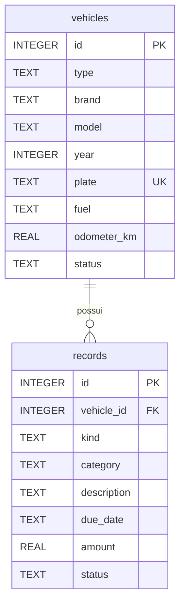
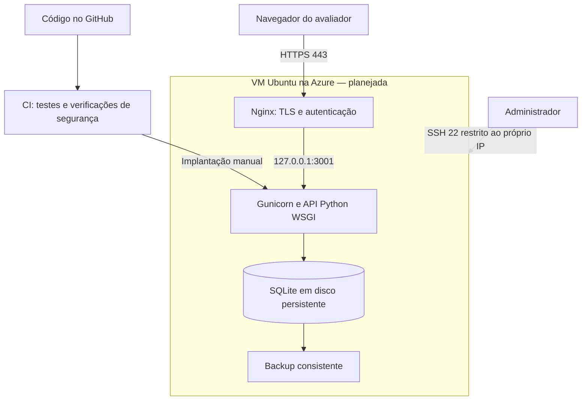

# Kaio Automóveis

**API de gestão de veículos com Python e SQLite, desenvolvida para a disciplina Cloud Security Prevention e DevSecOps.**

[](https://github.com/KaioRamos1/CP3---Cloud-Security/actions/workflows/ci.yml)

**Autor:** Kaio Ramos  
**Repositório:** [KaioRamos1/CP3---Cloud-Security](https://github.com/KaioRamos1/CP3---Cloud-Security)  
**Execução local:** <http://127.0.0.1:3001> — disponível depois de iniciar o servidor no seu computador.  
**Aplicação na Azure:** implantação pendente; ainda não há endereço HTTPS público para avaliação.

O sistema permite cadastrar, consultar, editar e excluir veículos, além de acompanhar custos e pendências registrados na API. A interface recebeu a marca **Kaio Automóveis**, com busca, filtros por motorização e identidade visual voltada à tecnologia e à mobilidade elétrica.

> **Para avaliar agora:** siga [Executar no Windows](#executar-no-windows). O projeto funciona localmente sem conta Azure e sem serviços externos. O banco é criado automaticamente na primeira execução. A hospedagem e as evidências de nuvem serão acrescentadas após a implantação.

## Navegação

- [Estado do projeto](#estado-do-projeto)
- [Executar no Windows](#executar-no-windows)
- [Executar no Linux ou macOS](#executar-no-linux-ou-macos)
- [Roteiro de avaliação](#roteiro-de-avaliação)
- [Testar a API pelo PowerShell](#testar-a-api-pelo-powershell)
- [Banco de dados e persistência](#banco-de-dados-e-persistência)
- [Testes e DevSecOps](#testes-e-devsecops)
- [Arquitetura e implantação na Azure](#arquitetura-e-implantação-na-azure)
- [Segurança e limites](#segurança-e-limites)
- [Estrutura e documentação](#estrutura-e-documentação)
- [Solução de problemas](#solução-de-problemas)
- [Evidências da entrega](#evidências-da-entrega)

## Estado do projeto

| Item | Situação |
|---|---|
| API Python e banco SQLite | Disponíveis para execução local |
| Testes automatizados | 18 testes existentes; comandos abaixo |
| Integração contínua | Configurada no GitHub Actions; o badge e os logs mostram o resultado do commit publicado |
| Cadastro de veículos pela interface | Disponível, com edição, exclusão, busca e filtros |
| Imagem decorativa do banner | Falha de exibição relatada no ambiente Windows; diagnóstico visual pendente |
| Azure, certificado HTTPS e autenticação pública | Scripts preparados; implantação ainda pendente |
| Prints da implantação e validação externa | Pendentes da execução na Azure |

A imagem do banner é ilustrativa e não é usada pela API ou pelo banco. Sua exibição deve ser conferida no navegador; os testes da API não comprovam a renderização visual. A movimentação implementada é um efeito sobre uma foto, com opção de pausa e respeito à preferência de movimento reduzido do sistema.

## Executar no Windows

### 1. Verificar os requisitos

Use um PowerShell comum, sem necessidade de abrir como administrador. É necessário ter:

- **Python 3.11 ou superior**. O workflow usa Python **3.12**, que é a versão de referência para reprodução.
- **Git**, para clonar o repositório.
- Um navegador atualizado, como Edge, Chrome ou Firefox.

Instaladores oficiais: [Python para Windows](https://www.python.org/downloads/windows/) e [Git para Windows](https://git-scm.com/download/win).

```powershell
py --version
git --version
```

Se `py` não existir, mas `python --version` retornar uma instalação real do Python, substitua `py` por `python` nos comandos deste guia. Se ambos falharem, instale o Python e abra um novo PowerShell antes de continuar.

**Não é necessário executar `pip install` no modo local.** A API usa WSGI e módulos da biblioteca padrão, incluindo `sqlite3`. O arquivo `requirements.txt` é utilizado na implantação Linux com Gunicorn.

### 2. Clonar o projeto e entrar na pasta correta

Os comandos abaixo criam a pasta `CP3---Cloud-Security` dentro da pasta do seu usuário:

```powershell
cd "$env:USERPROFILE"
git clone https://github.com/KaioRamos1/CP3---Cloud-Security.git
cd .\CP3---Cloud-Security
```

Confira que está na raiz do projeto:

```powershell
Get-Item .\app.py, .\schema.sql, .\test_api.py, .\dashboard.html
```

Se a pasta já existir por uma clonagem anterior, entre nela em vez de clonar novamente. Para atualizar uma cópia sem alterações locais, use `git pull --ff-only`. Se o Git informar conflito ou alterações locais, preserve seu trabalho antes de atualizar.

Também é possível baixar **Code → Download ZIP** no GitHub. Extraia o ZIP inteiro e abra o PowerShell dentro da pasta extraída que contém `app.py`. O arquivo ZIP de uma atualização visual, isoladamente, não contém o projeto completo.

### 3. Executar os testes

```powershell
py -m unittest -v test_api.py
```

Resultado esperado nesta versão:

```text
Ran 18 tests in ...s

OK
```

Os testes usam bancos temporários e não alteram os veículos do banco local. Se houver `FAILED` ou `ERROR`, consulte [Solução de problemas](#solução-de-problemas) antes de continuar.

### 4. Iniciar o servidor

```powershell
py app.py --seed
```

O terminal deve informar:

```text
Desenvolvimento local: http://127.0.0.1:3001
```

**Deixe esse terminal aberto** e acesse <http://127.0.0.1:3001> no navegador. O modo local não pede usuário ou senha.

Abra o site pelo endereço HTTP. Abrir `dashboard.html` com duplo clique não inicia a API e não permite utilizar o cadastro corretamente.

O parâmetro `--seed` adiciona **três veículos e uma revisão demonstrativa somente na primeira inicialização de um banco novo**. Não recria registros apagados nem substitui dados existentes. Se a base já foi inicializada sem demonstração, ela continuará vazia até você cadastrar veículos.

Para encerrar, pressione **Ctrl+C** no terminal do servidor. Para abrir novamente:

```powershell
py app.py
```

### 5. Confirmar a resposta da API

Com o servidor aberto, execute em **outro PowerShell**:

```powershell
Invoke-RestMethod -Uri "http://127.0.0.1:3001/api/health" | ConvertTo-Json
```

Resposta esperada:

```json
{
  "status": "ok",
  "database": "ok"
}
```

## Executar no Linux ou macOS

Com Git e Python 3.11+ instalados, use um terminal normal:

```bash
cd ~
git clone https://github.com/KaioRamos1/CP3---Cloud-Security.git
cd CP3---Cloud-Security
python3 --version
python3 -m unittest -v test_api.py
python3 app.py --seed
```

Abra <http://127.0.0.1:3001>. Para parar, pressione **Ctrl+C**. A execução local também usa somente a biblioteca padrão; não é necessário instalar Gunicorn para seguir esse roteiro.

## Roteiro de avaliação

1. **Listar:** abra a página e confira os veículos. Em uma base recém-criada com `--seed`, aparecem Toyota Corolla, Honda Civic e Honda CG 160.
2. **Cadastrar:** clique em **Cadastrar veículo** e informe marca, modelo, ano, placa e quilometragem. Exemplo de placa válida: `AVA1B23`, desde que ainda não esteja cadastrada.
3. **Filtrar:** escolha a motorização **Elétrico** no cadastro e use o filtro **Elétricos** após salvar. Veículos antigos sem motorização informada permanecem em **Todos**.
4. **Editar:** altere modelo ou quilometragem, salve e confira a mudança na lista.
5. **Verificar persistência:** pare o servidor com Ctrl+C, execute `py app.py` novamente e recarregue a página. O veículo deve continuar salvo.
6. **Excluir:** remova somente o veículo criado para o teste e confirme a exclusão. Seus registros de custos e serviços associados também são excluídos.
7. **Validar a API:** execute os exemplos abaixo e confira as respostas.

O dashboard mostra os custos registrados no mês e até dez registros pendentes. A criação e a edição desses **registros de custos e serviços** são feitas pela API; o formulário da interface é destinado aos veículos. Os indicadores não representam telemetria, bateria ou autonomia em tempo real.

## Testar a API pelo PowerShell

Use um segundo PowerShell enquanto `py app.py` continua rodando. Estes exemplos são para o **ambiente local**.

### Saúde e listagem

```powershell
$base = 'http://127.0.0.1:3001'
$headers = @{ 'X-Requested-With' = 'MinhaFrota' }

Invoke-RestMethod -Uri "$base/api/health"
(Invoke-RestMethod -Uri "$base/api/vehicles").data |
    Format-Table id, brand, model, plate, fuel, odometer_km
```

### Cadastrar um veículo

O cabeçalho de escrita continua sendo `MinhaFrota`, mesmo com a nova marca do site.

```powershell
$body = @{
    type = 'carro'
    brand = 'BYD'
    model = 'Dolphin'
    year = 2025
    plate = 'API9Z87'
    fuel = 'Elétrico'
    odometer_km = 1500
    status = 'ativo'
} | ConvertTo-Json

$utf8 = [System.Text.Encoding]::UTF8.GetBytes($body)
$criado = $null
$veiculoId = $null
$criado = Invoke-RestMethod -Uri "$base/api/vehicles" `
    -Method Post -Headers $headers `
    -ContentType 'application/json; charset=utf-8' -Body $utf8 -ErrorAction Stop

$veiculoId = $criado.data.id
$criado | ConvertTo-Json -Depth 5
```

A API retorna **HTTP 201** e os dados do veículo com seu ID. O `Invoke-RestMethod` mostra o corpo convertido em objeto. Se receber **409**, a placa já existe: escolha outra placa válida ou exclua, de forma consciente, o veículo de teste anterior. Não continue usando um ID antigo após um POST com erro.

### Consultar e editar o veículo criado

Continue na mesma janela para reutilizar `$base`, `$headers` e `$veiculoId`:

```powershell
Invoke-RestMethod -Uri "$base/api/vehicles/$veiculoId" |
    ConvertTo-Json -Depth 5

Invoke-RestMethod -Uri "$base/api/vehicles/$veiculoId" `
    -Method Put -Headers $headers `
    -ContentType 'application/json' `
    -Body '{"odometer_km":1600}' |
    ConvertTo-Json -Depth 5
```

O GET e o PUT retornam **HTTP 200**. Neste projeto, PUT permite atualização parcial dos campos. Ao atualizar a página, a quilometragem deve aparecer como **1.600 km**.

### Excluir somente o veículo criado no exemplo

```powershell
Invoke-RestMethod -Uri "$base/api/vehicles/${veiculoId}?confirm=true" `
    -Method Delete -Headers $headers
```

O resultado é **HTTP 204, sem corpo de resposta**. Não aparecer texto no terminal é esperado. Consultar esse mesmo ID após a exclusão deve retornar **404**.

### Rotas disponíveis

| Método | Rota | Finalidade |
|---|---|---|
| GET | `/api/health` | Verificar API e acesso ao banco |
| GET / POST | `/api/vehicles` | Listar ou cadastrar veículos |
| GET / PUT / DELETE | `/api/vehicles/{id}` | Consultar, atualizar ou excluir veículo |
| GET / POST | `/api/records` | Listar ou cadastrar custos e serviços |
| GET / PUT / DELETE | `/api/records/{id}` | Consultar, atualizar ou excluir registro |
| GET | `/api/dashboard` | Veículos ativos, custos do mês e pendências |
| GET | `/api/reports/costs` | Total por tipo e categoria, sem filtro de período |

Filtros da API: `/api/vehicles?type=moto` e `/api/records?vehicle_id=ID_REAL`. A busca textual e os filtros por motorização da interface são aplicados no navegador. POST e PUT exigem JSON; POST, PUT e DELETE exigem `X-Requested-With: MinhaFrota`; DELETE exige `?confirm=true`.

Consulte o [contrato completo da API](docs/API.md) para campos, exemplos de custos, validações e códigos de erro.

## Banco de dados e persistência

O SQLite é um arquivo local da aplicação. **Não é necessário instalar MySQL, PostgreSQL, SQL Server ou criar Azure SQL Database.** O esquema é criado automaticamente a partir de [schema.sql](schema.sql).

| Ambiente | Local padrão do banco |
|---|---|
| Windows | `%LOCALAPPDATA%\MinhaFrotaCloud\minha_frota.sqlite3` |
| Linux/macOS local | `~/.local/share/MinhaFrotaCloud/minha_frota.sqlite3` |
| VM com o serviço preparado | `/var/lib/minhafrota/minha_frota.sqlite3` |

O nome técnico `MinhaFrotaCloud` foi preservado para manter a compatibilidade com os dados anteriores. Quando `MINHA_FROTA_DATA_DIR` estiver definida, ela substitui o diretório padrão. Reiniciar o processo preserva os registros. Os testes automatizados usam outro banco temporário.



`records.vehicle_id` referencia `vehicles.id`, com exclusão em cascata. A tabela `app_meta` controla a inicialização dos dados demonstrativos. O banco utiliza WAL, chaves estrangeiras e consultas com valores parametrizados.

### Avaliação com uma base separada

Para testar sem reutilizar o banco padrão, encerre o servidor e, na raiz do projeto, execute:

```powershell
$env:MINHA_FROTA_DATA_DIR = Join-Path $env:LOCALAPPDATA 'KaioAutomoveisAvaliacao'
py app.py --seed
```

Essa pasta terá sua própria base persistente. O comando não apaga nem altera o banco padrão. Depois de encerrar o servidor de avaliação com Ctrl+C, volte ao caminho padrão nesta janela:

```powershell
Remove-Item Env:MINHA_FROTA_DATA_DIR
```

### Backup consistente no Windows

Na raiz do projeto, usando outra janela de PowerShell, este exemplo considera o **caminho padrão** do banco:

```powershell
$origem = Join-Path $env:LOCALAPPDATA 'MinhaFrotaCloud\minha_frota.sqlite3'
$destino = Join-Path $env:LOCALAPPDATA ('KaioAutomoveisBackups\backup-' + (Get-Date -Format 'yyyyMMdd-HHmmss-fff') + '.sqlite3')
py deploy/backup.py "$origem" "$destino"
```

Se estiver usando um diretório personalizado, ajuste `$origem` para o banco correto. O script usa a API de backup do SQLite, verifica a integridade e não sobrescreve um backup existente. A saída de sucesso inclui `integrity_check=ok`. Uma cópia no mesmo computador não protege contra a perda desse equipamento; o [guia Azure](docs/GUIA_AZURE.md) inclui cópia e recuperação em ambiente separado.

## Testes e DevSecOps

O workflow [Testes e segurança](.github/workflows/ci.yml) roda em pushes, pull requests e execução manual. Ele usa Ubuntu 24.04 e Python 3.12, com permissão de repositório `contents: read`.

| Etapa | O que verifica |
|---|---|
| `unittest` | 18 testes de CRUD, validação, persistência, integridade de backup, respostas HTTP e controles da API |
| Bandit | Análise estática de `app.py` e `deploy/backup.py`; configuração atual `-ll`, a partir de severidade média |
| pip-audit | Vulnerabilidades conhecidas nas dependências de implantação listadas em `requirements.txt` |
| `bash -n` | Sintaxe dos scripts Linux de instalação e recarga do Nginx |
| Dependabot | Verificação semanal de atualizações de pacotes Python e ações do GitHub |

Consulte a [execução do workflow](https://github.com/KaioRamos1/CP3---Cloud-Security/actions/workflows/ci.yml) e seu **commit** antes de avaliar ou implantar. O badge é dinâmico; uma execução antiga aprovada não comprova um commit novo.

O pipeline não publica a aplicação na Azure. A implantação é manual, depois da aprovação dos checks. Os testes automatizados não substituem a validação visual no navegador nem comprovam ausência de vulnerabilidades.

## Arquitetura e implantação na Azure

**Esta seção descreve a implantação planejada. Ainda não representa um ambiente Azure publicado e validado.**



| Elemento | Papel no projeto |
|---|---|
| Python / WSGI | API e validações, usando a biblioteca padrão no modo local |
| HTML, CSS e JavaScript | Interface e chamadas à API no mesmo endereço do site |
| VM Ubuntu 24.04 LTS x64 | Servidor que executará a aplicação |
| SKU sugerido `Standard_B2ts_v2` | 2 vCPUs e 1 GiB de RAM; sujeito a disponibilidade, quota e orçamento |
| Disco gerenciado Standard SSD LRS | Armazenamento persistente do sistema, aplicação e arquivo SQLite |
| Rede virtual, interface de rede e NSG | Conectividade e controle das portas de entrada |
| IP público Standard e nome DNS | Endereço para acesso e emissão do certificado |
| Nginx e Certbot | HTTPS, autenticação e renovação de certificado |
| Gunicorn e systemd | Execução da API em loopback e gerenciamento do serviço |

O SKU é uma **sugestão**, não um recurso já contratado. Região, tamanho, capacidade do disco e custos reais devem ser conferidos no portal e registrados no relatório. O SQLite precisa permanecer no disco persistente; não use armazenamento efêmero para seus dados.

### Sequência de implantação

1. Confirme que o código completo está no GitHub e que os checks do commit escolhido passaram.
2. Crie uma VM Ubuntu dedicada ao laboratório, com autenticação por chave SSH e disco persistente.
3. No NSG, permita **22/TCP somente do IP público do administrador**, **80/TCP** para validação do certificado/redirecionamento e **443/TCP** para o site. Não abra 3001 para a internet.
4. Configure um nome DNS no IP público e confirme que ele resolve para a VM. Copie o nome completo retornado pelo Azure.
5. Conecte por SSH e execute, **no Ubuntu da VM**, os comandos abaixo.

```bash
sudo apt-get update
sudo apt-get install -y git curl
git clone https://github.com/KaioRamos1/CP3---Cloud-Security.git
cd CP3---Cloud-Security
git rev-parse HEAD
```

O clone pressupõe acesso ao repositório. Se ele estiver privado, configure um método autorizado de autenticação Git; não coloque tokens no endereço do repositório.

Substitua `SEU_DNS_COMPLETO` e `SEU_EMAIL` por valores reais antes de executar:

```bash
sudo bash deploy/install.sh SEU_DNS_COMPLETO SEU_EMAIL
```

O instalador executa os testes, instala as dependências, configura o serviço `minhafrota`, inicializa o banco e solicita a senha do usuário **`avaliador`**. O serviço habilita dados demonstrativos somente em uma base nova. A emissão do certificado usa Certbot e aceita os termos da autoridade certificadora.

Durante a configuração inicial, a porta 80 permite a validação do certificado e responde 503 para a aplicação. O acesso público ao sistema é habilitado depois de configurar HTTPS e autenticação.

Valide na VM:

```bash
sudo systemctl status minhafrota --no-pager
sudo nginx -t
curl --fail http://127.0.0.1:3001/api/health
sudo certbot renew --dry-run
```

Depois, em um PowerShell **fora da sessão SSH**, substitua o DNS real:

```powershell
curl.exe -i https://SEU_DNS_COMPLETO/api/health
curl.exe -i -u avaliador https://SEU_DNS_COMPLETO/api/health
```

O primeiro acesso deve retornar **401**; o segundo solicita a senha e deve retornar **200**. Abra `https://SEU_DNS_COMPLETO` no navegador para testar o CRUD. A senha deve ser entregue ao professor por um canal privado.

O roteiro completo de criação da VM, rede, DNS, SSH, backup, recuperação e encerramento do laboratório está em [docs/GUIA_AZURE.md](docs/GUIA_AZURE.md). Os nomes técnicos `minhafrota` foram preservados no serviço e nos caminhos para manter a compatibilidade com os scripts.

## Segurança e limites

| Controle | Implementação |
|---|---|
| Validação de entrada | Campos permitidos, tipos, valores, datas e placa única; corpo JSON de até 64 KiB |
| Acesso SQL | Valores parametrizados; tabelas e campos dinâmicos restritos a listas permitidas |
| Renderização de texto | Conteúdo dos veículos inserido com `textContent`, com CSP como proteção adicional |
| Requisições de escrita | Cabeçalho customizado obrigatório e ausência de CORS |
| Arquivos públicos | Rotas estáticas explicitamente permitidas pela API |
| Execução local | Servidor vinculado a `127.0.0.1`, sem autenticação própria |
| Implantação preparada | Gunicorn em loopback, Nginx com HTTPS e Basic Auth, serviço Linux sem root |
| Versionamento | Banco, chaves, `.env` e backups ignorados pelo `.gitignore` |

O cabeçalho `X-Requested-With` é um controle para requisições de navegador de outra origem; **não é uma senha**. Na nuvem, a autenticação depende do Nginx. A conta `avaliador` tem acesso completo às operações e não representa autorização individual por usuário.

Este é um laboratório com uma VM e um arquivo SQLite. Não há alta disponibilidade, identidades individuais, RBAC, WAF, backup remoto automático ou implantação automática. O limite de requisições do Nginx não equivale a proteção contra DDoS volumétrico. O uso de `REAL` para valores monetários segue o modelo didático; uma aplicação financeira exigiria uma política de precisão apropriada.

## Estrutura e documentação

| Caminho | Conteúdo |
|---|---|
| [`app.py`](app.py) | API WSGI, validações, SQLite e servidor local |
| [`schema.sql`](schema.sql) | Tabelas, relacionamentos e índices |
| [`dashboard.html`](dashboard.html) | Estrutura da interface |
| [`static/`](static/) | JavaScript, CSS e imagem ilustrativa |
| [`test_api.py`](test_api.py) | Testes automatizados |
| [`requirements.txt`](requirements.txt) | Dependência do servidor Linux |
| [`.github/workflows/ci.yml`](.github/workflows/ci.yml) | Pipeline de testes e segurança |
| [`.github/dependabot.yml`](.github/dependabot.yml) | Atualizações de dependências e ações |
| [`deploy/`](deploy/) | Instalador, systemd, Nginx, renovação TLS e backup |
| [`docs/API.md`](docs/API.md) | Contrato completo da API |
| [`docs/GUIA_AZURE.md`](docs/GUIA_AZURE.md) | Guia de implantação e recuperação |
| [`docs/SEGURANCA_E_EVIDENCIAS.md`](docs/SEGURANCA_E_EVIDENCIAS.md) | Controles, limites e roteiro de prints |
| [`docs/arquitetura.png`](docs/arquitetura.png) | Esquema visual de arquitetura |
| [`docs/modelo-dados.png`](docs/modelo-dados.png) | Modelo visual de dados |
| [`evidencias/`](evidencias/) | Registros de validação e evidências da atividade |

O script `Iniciar-MinhaFrota.ps1` é um atalho opcional que utiliza o comando `python`. O roteiro principal deste README usa `py app.py` no Windows e não exige alterar a política de execução do PowerShell.

## Solução de problemas

| Sintoma | Verificação e ação |
|---|---|
| `Python was not found` | Teste `py --version`. Se não funcionar, instale o Python e reabra o terminal |
| `No module named test_api` | Você está fora da raiz do projeto. Entre na pasta que contém `test_api.py` e `app.py` |
| `git clone` informa que a pasta já existe | Entre no clone existente; não execute `git init` novamente |
| A página não abre | Confirme que `py app.py` continua rodando e acesse `http://127.0.0.1:3001` |
| Abriu uma página antiga | Confira a pasta do processo em execução, encerre esse servidor, reinicie no projeto correto e use Ctrl+F5 |
| `WinError 10048` / endereço em uso | Já existe um processo nessa porta. Encerre o servidor anterior ou use a alternativa abaixo |
| Nenhum veículo demonstrativo | O banco pode ter sido inicializado antes. Cadastre pela tela ou use uma base separada; `--seed` não repovoa uma base existente |
| Erro 409 ao salvar | A placa já está cadastrada; na API também pode haver relacionamento inválido ou DELETE sem confirmação |
| Erro 403 em escrita na API | Envie `X-Requested-With: MinhaFrota` |
| Erro 415 | Envie `Content-Type: application/json` em POST/PUT |
| Botão indica “Movimento reduzido” | A animação respeita a preferência de acessibilidade do sistema; isso não explica, por si só, uma imagem ausente |
| SSH não conecta na Azure | Confira IP, usuário, chave e a regra 22/TCP restrita ao seu IP atual |
| Certificado não é emitido | Confira DNS apontando para a VM, porta 80 e mensagens do Certbot |

### Usar outra porta local

Na raiz do projeto, antes de iniciar o servidor:

```powershell
$env:MINHA_FROTA_PORT = '3002'
py app.py
```

Abra <http://127.0.0.1:3002> e use essa mesma porta nos exemplos da API. Depois de encerrar o processo com Ctrl+C, remova a configuração para voltar à porta padrão:

```powershell
Remove-Item Env:MINHA_FROTA_PORT
```

### A imagem do banner não aparece

Com o servidor aberto, acesse diretamente <http://127.0.0.1:3001/static/kaio-hero.png>. Em outro PowerShell, na raiz do projeto, confira:

```powershell
Test-Path .\static\kaio-hero.png
Select-String -Path .\app.py -SimpleMatch '/static/kaio-hero.png'
```

- Se o primeiro comando retornar **False**, o arquivo não está nessa cópia. Confira se `static/kaio-hero.png` foi incluído no commit publicado.
- Se não aparecer a rota no segundo comando, a API dessa cópia ainda não contém o caminho da imagem.
- Se arquivo e rota existem, mas o endereço retorna **404**, encerre o processo antigo e inicie novamente o `app.py` da pasta correta. Alterações no código Python exigem reiniciar o servidor.
- Se a imagem abrir diretamente, mas ficar invisível na página, investigue o CSS aplicado e extensões que alteram o visual do navegador. Uma comparação em outro navegador ajuda a separar as causas.

## Evidências da entrega

Os resultados esperados deste README são instruções de verificação, não evidências de uma implantação concluída. Registre os resultados reais com data, ambiente e commit.

| Evidência | O que registrar |
|---|---|
| Execução local | Comando de início, endereço do navegador e saúde da API |
| CRUD | Criação, consulta, alteração e exclusão de um veículo de teste |
| Persistência | Registro antes e depois de reiniciar o servidor |
| Testes e CI | Resultado dos testes e link da execução do commit avaliado |
| VM e armazenamento | Região, sistema, SKU, vCPU, RAM, tipo e capacidade do disco efetivamente usados |
| Rede e HTTPS | NSG, endereço público, certificado e validação 401/200 |
| Backup e recuperação | Integridade do backup e leitura em uma base separada |

Antes da entrega final, atualize este README com a **URL HTTPS real**, o **hash do commit implantado**, o **link da execução aprovada** e os **caminhos dos prints e do relatório Word/PDF** que forem adicionados ao repositório. Não publique credenciais nos arquivos ou nas capturas.

## Créditos e referências

A aplicação foi adaptada da base didática **Minha Frota**, de **Eduardo Popovici**, com a licença MIT original preservada. A identidade visual Kaio Automóveis foi acrescentada nesta versão. O nome de origem continua em identificadores técnicos necessários à compatibilidade.

- [Licença MIT](LICENSE)
- [Material de origem](docs/ORIGEM.md)
- [Referências do projeto](docs/REFERENCIAS.md)
- [Documentação do módulo sqlite3 do Python](https://docs.python.org/3/library/sqlite3.html)
- [Criar uma VM Linux no portal Azure](https://learn.microsoft.com/pt-br/azure/virtual-machines/linux/quick-create-portal)
- [Especificações dos tamanhos Bsv2](https://learn.microsoft.com/en-us/azure/virtual-machines/sizes/general-purpose/bsv2-series)
