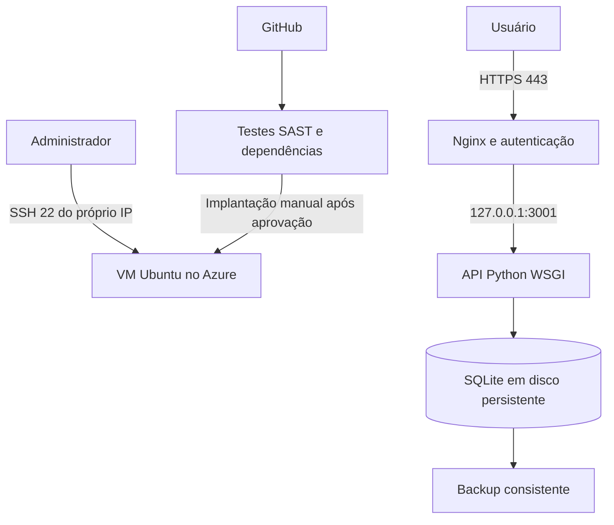

# Minha Frota no Azure

Projeto acadêmico para **Cloud Security Prevention e DevSecOps**, adaptado da base didática de Eduardo Popovici (licença MIT preservada).

API REST em **Python**, banco **SQLite**, dashboard HTML/CSS/JavaScript, hospedagem proposta em **VM Azure Ubuntu**, com **Gunicorn + Nginx + HTTPS**. A aplicação usa WSGI e a biblioteca padrão; não utiliza Flask ou FastAPI.

## Estado da entrega

- API e testes locais: executados; 18 testes aprovados, incluindo CRUD, persistência, validação e proteção de escrita contra requisições de navegador de outra origem.
- Dashboard: código preparado; inspeção estática do DOM. Não foi validado em navegador nesta execução.
- Configuração Linux: arquivos preparados e scripts com sintaxe validada; Gunicorn, Nginx e certificados precisam ser validados na VM.
- CI: workflow preparado; SAST e auditoria de dependências dependem da execução no GitHub. Não foram executados neste ambiente por indisponibilidade das dependências.
- Azure, HTTPS público, prints e repositório remoto: **pendentes de implantação e captura na conta do aluno**.

## Começar no Windows

Extraia o ZIP. Abra o PowerShell na pasta que contém `app.py`:

```powershell
python --version
python -m unittest -v test_api.py
python app.py --seed
```

Abra <http://127.0.0.1:3001>. Para parar, `Ctrl+C`. Python 3.11 ou superior é necessário; validação local feita com Python 3.12. Não é necessário instalar dependências para este modo local.

O banco local é criado em `%LOCALAPPDATA%\MinhaFrotaCloud\minha_frota.sqlite3`; se a variável não existir, usa `~/.local/share/MinhaFrotaCloud`. O parâmetro `--seed` preenche somente uma base nova. Reiniciar não recria os dados que você excluiu.

## Documentação

1. [Guia do Azure e GitHub](docs/GUIA_AZURE.md) — do Windows à URL pública.
2. [Contrato da API](docs/API.md) — rotas, exemplos e validações.
3. [Segurança e evidências](docs/SEGURANCA_E_EVIDENCIAS.md) — controles, limites e prints.
4. [Arquitetura](docs/arquitetura.png) e [modelo de dados](docs/modelo-dados.png).
5. `evidencias/` — saídas reais dos testes locais; acrescente os prints da sua implantação.

## Links da entrega

Preencher depois da publicação:

- Repositório GitHub: **PENDENTE**
- Aplicação HTTPS: **PENDENTE**
- Commit implantado: **PENDENTE**
- Execução aprovada do GitHub Actions: **PENDENTE**

O login `avaliador` é criado durante a instalação. Envie a senha ao professor por um canal privado, fora do repositório e dos prints.

## Arquitetura



## Limites

Uma VM, um banco e uma conta de demonstração com acesso completo. Não há alta disponibilidade, RBAC por usuário, WAF, backup remoto automático ou CD automático. O rate limiting do Nginx não equivale a proteção contra DDoS volumétrico. A autenticação é implementada pelo proxy e a API deve permanecer em loopback.
